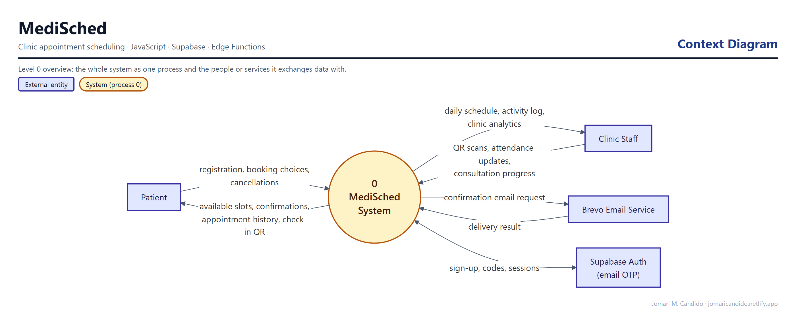
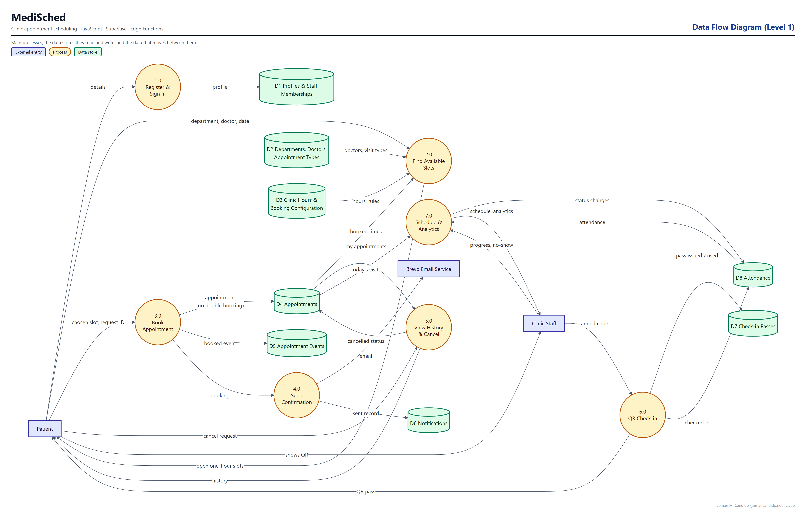
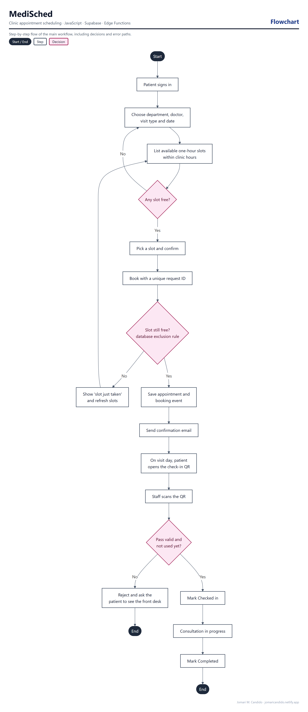

# MediSched

[Live application](https://mymedisched.netlify.app/)

Clinic appointment scheduling system developed by **Jomari M. Candido**. Built with vanilla HTML, CSS and JavaScript, Supabase Auth/PostgreSQL, Supabase Edge Functions, Brevo email and Netlify.

- Patient registration with email verification and OTP resend
- Available appointment slots, booking, history and cancellation
- Database-enforced overlap prevention and clinic hours
- Expiring opaque QR passes with staff camera/manual check-in
- Staff schedule, consultation progress and clinic analytics
- Responsive phone layouts, light/dark themes and medical illustrations

Appointments last one hour, starting at 15-minute intervals. The clinic schedule is every day, 8 AM–5 PM, with lunch from 12 PM–1 PM. All schedules use Philippine time.

## System design

These diagrams were drawn from the app's actual database schema, roles and code paths.

**Context diagram.** MediSched as a single process, and the people and outside services it exchanges data with.



**Data flow diagram (Level 1).** The main processes, the data stores they read and write (grouped from the database tables), and the data that moves between them.



**Flowchart: booking and QR check-in.** The main workflow step by step, including decisions and error paths.



## Run locally

```sh
cd MediSched
npm ci
npm run serve
```

Open http://127.0.0.1:5173. Local configuration targets the separate staging backend. Only public browser credentials are committed; server-side credentials belong in Supabase secrets.

## Production build

```sh
cd MediSched
npm run build:production
```

Upload `MediSched/dist` to the existing Netlify site. For Git-connected Netlify builds, use base directory `MediSched`, build command `npm run build:production`, publish directory `dist`. Plain `npm run build` retains the local staging configuration.

## Verification and setup

Run `npm test` from `MediSched` for unit tests. Database integration tests require the isolated local PostgreSQL fixture; see [project README](MediSched/README.md). Browser audit scripts use the installed Playwright CLI.

See [audit report](MediSched/AUDIT.md), [production setup](MediSched/PRODUCTION_SETUP.md), and [QR/analytics setup](MediSched/docs/qr-analytics-setup.md). Do not replay SQL migrations against an already-configured production database.
